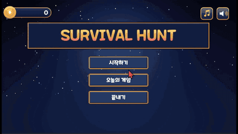
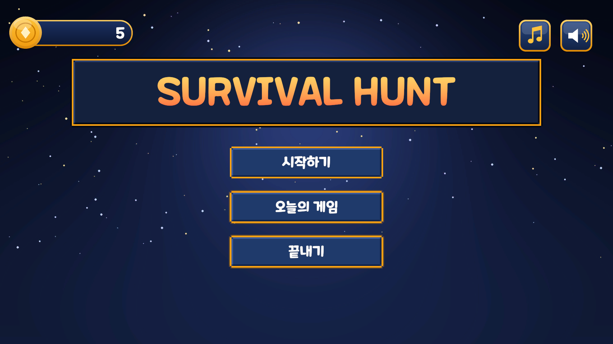
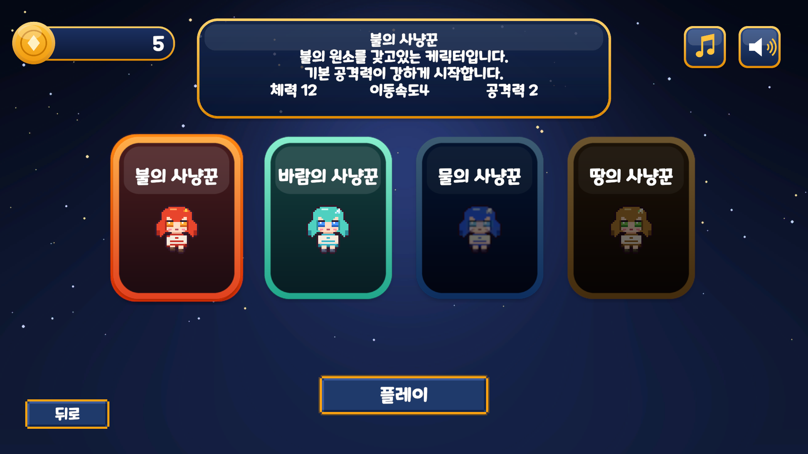
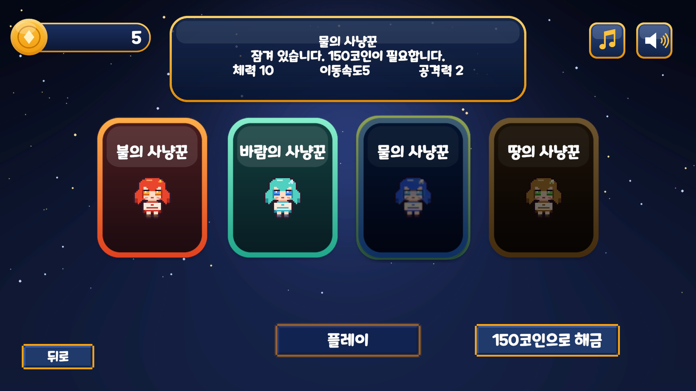
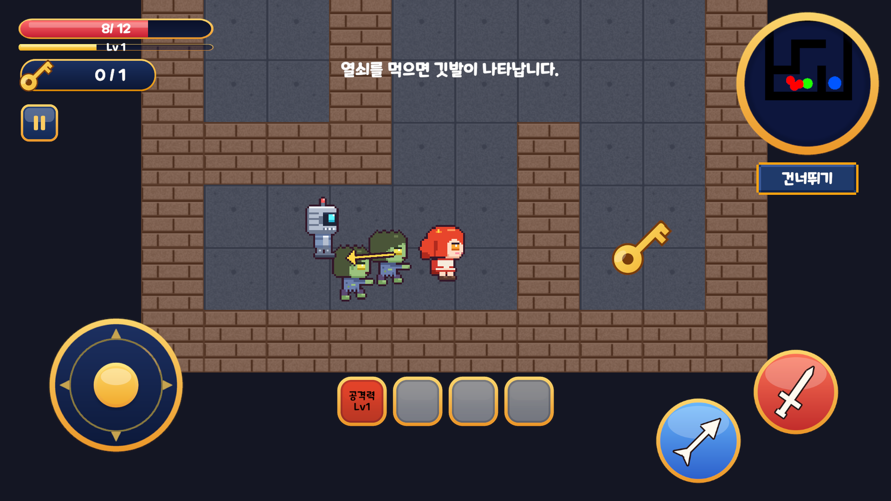
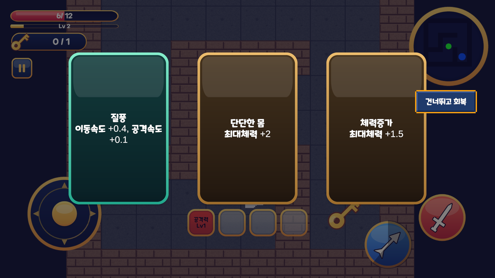
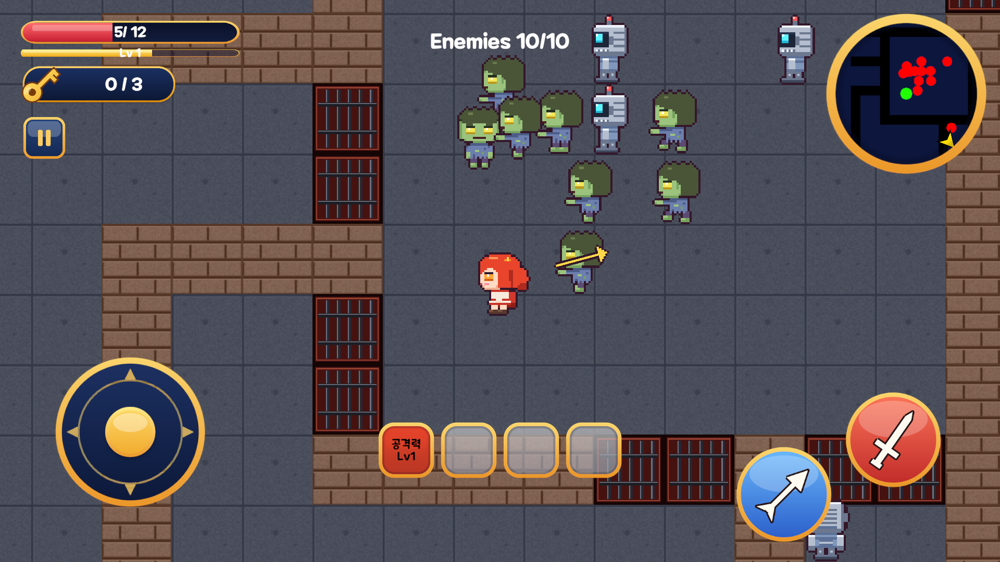
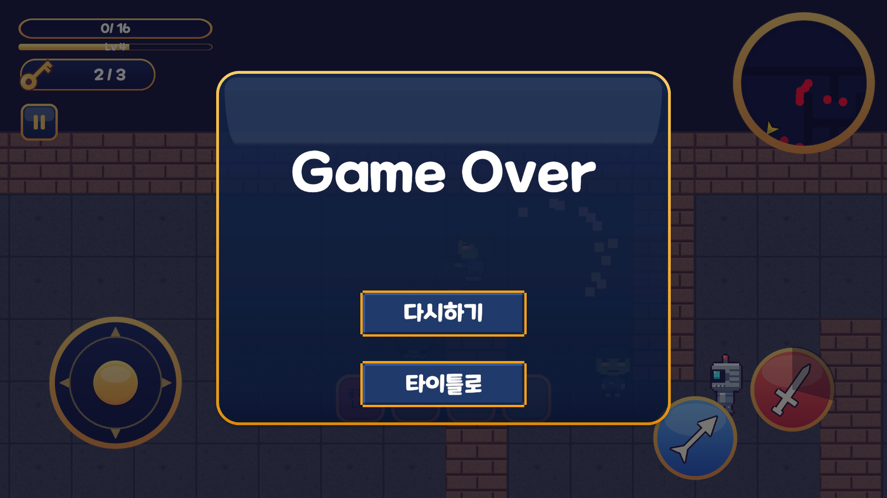
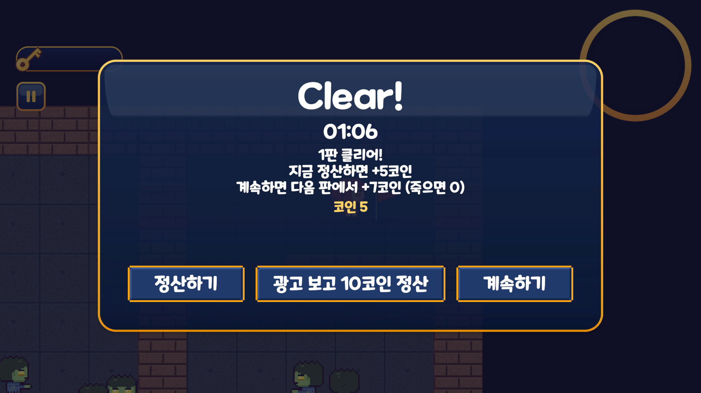

# Survival Hunt

> 미로 속 몬스터를 사냥하고, 카드를 골라 성장하며, 출구까지 살아남는 2D 서바이벌 액션 모바일 게임

| | |
|---|---|
| 장르 | 2D 서바이벌 액션 / 로그라이트 |
| 엔진 | Unity 6000.3.8f1 (2D URP, C#) |
| 플랫폼 | Android (가로 화면) |
| 개발 | 1인 개발: 기획, 프로그래밍, UI, 캐릭터 애니메이션, 스토어 출시 준비 |
| 상태 | Google Play 비공개 테스트 진행 중 (출시 준비) |

## 플레이 영상


유튜브에서 전체 영상을 보실수 있습니다. https://youtu.be/djVPuocOTgk

## 스크린샷

| 타이틀 | 캐릭터 선택 | 잠긴 캐릭터 |
|:---:|:---:|:---:|
|  |  |  |

| 튜토리얼 | 능력 카드 선택 | 전투 |
|:---:|:---:|:---:|
|  |  |  |

| 게임 오버 | 클리어 / 정산 |
|:---:|:---:|
|  |  |

## 한눈에 보기

조이스틱으로 이동하면 자동으로 공격하고, 레벨업마다 카드 3장 중 하나를 골라 성장합니다. 판을 클리어할 때마다 **"코인을 정산하고 돌아갈지, 위험을 안고 다음 판으로 갈지"** 를 선택하는 리스크 구조가 핵심입니다.

- **4명의 사냥꾼**: 불, 바람, 물, 땅. 캐릭터별 능력치와 시작 카드가 다르며 물, 땅은 코인으로 해금합니다.
- **카드 성장**: 슬롯 4개, 카드 최대 5레벨, 같은 속성을 모으면 시너지가 발동합니다.
- **절차적 미로**: 매 판 새로 생성되고, 판이 지날수록 맵이 커지고 적이 강해집니다.
- **열쇠와 출구**: 미로에 흩어진 열쇠를 모두 모으면 출구 깃발이 나타나고, 깃발에 닿으면 다음 판으로 넘어갑니다.
- **정산 / 계속**: 계속하다 죽으면 정산하지 않은 코인을 잃습니다.
- **오늘의 게임**: 날짜 기반 시드로 모두에게 같은 미로를 제공합니다.
- **보상형 광고**: 광고를 보면 정산 코인이 두 배가 됩니다 (Unity LevelPlay).
- **튜토리얼, 일시정지, 소리 설정**: 처음 하는 사람도 쉽게 시작하고, 배경음과 효과음을 따로 끌 수 있습니다.

## 기술적으로 다룬 문제

### 1. 데이터 주도 설계 (ScriptableObject)
캐릭터와 카드를 코드가 아니라 데이터 에셋으로 정의했습니다. 새 카드나 캐릭터를 추가할 때 코드 수정 없이 에셋만 만들면 됩니다. 카드 하나에 여러 효과를 줄 수 있도록 `CardEffectEntry[]` 구조로 확장했습니다.

### 2. 카드 효과 합산과 속성 시너지 (`CardManager`)
슬롯에 담긴 카드를 순회하며 `효과값 × 레벨`을 합산하고, 같은 속성 개수에 따라 시너지 단계를 적용합니다. 효과 적용을 `AddEffect(effect, value)` 하나로 모아서 카드 종류가 늘어도 로직이 한 곳에 있습니다.

### 3. 절차적 미로 생성과 시드 (`MazeGenerator`)
- 판 단계에 따라 맵 크기를 키웁니다 (가로, 세로 +2칸, 방 +1개, 최대 15칸).
- 오늘의 게임은 날짜에서 만든 시드를 사용해서 같은 날 모든 플레이어가 같은 미로를 받습니다.

### 4. 난이도 곡선 (`Difficulty`)
단계 S에 대해 계산식을 한 곳(`Difficulty`)에 모았습니다.

| 항목 | 배율 |
|---|---|
| 체력 | `1 + 0.3 × (S−1)` |
| 이동 속도 | `1 + 0.08 × (S−1)` |
| 스폰 간격 | `0.9^(S−1)` (최소 0.3초) |

### 5. 오브젝트 풀링과 배율 중복 적용 방지
적은 풀링으로 재사용합니다. 난이도 배율을 꺼낼 때마다 적용하면 재사용할 때 배율이 누적되므로, 풀의 생성 시점(`createFunc`)에 한 번만 적용하도록 했습니다.

### 6. 판 사이 상태 이어받기 (`GameSession`)
씬을 다시 로드해도 체력, 카드, 레벨이 이어지도록 정적 세션 객체에 저장하고 불러옵니다(`SaveToSession` / `LoadFromSession`). 이어받기가 끝나면 플래그를 내려서 다음 판에 잘못 적용되지 않게 합니다.

### 7. 보상 경제 설계
- 판 클리어 보상: `5 + 2 × (클리어 판 수 − 1)` 코인
- 정산하지 않고 죽으면 0, 광고 시청 시 정산액 2배
- 코인 저장은 `PlayerPrefs`, 변경은 이벤트(`CoinWallet.Changed`)로 UI에 전달

### 8. 광고 연동 (Unity LevelPlay)
- 보상은 광고를 끝까지 봤을 때(`OnAdRewarded`)에만 지급하고, 닫기(`OnAdClosed`)로는 지급하지 않습니다.
- 정산 중복 지급을 막기 위한 가드를 두었습니다.
- 광고 선언, 데이터 보안 양식, 개인정보처리방침을 Play Console 기준에 맞춰 작성했습니다.

### 9. 소리 설정 (`SoundSettings`)
배경음과 효과음 설정을 static 클래스 한 곳에 저장하고(`PlayerPrefs`), 값이 바뀌면 이벤트(`Changed`)로 알려서 씬마다 있는 배경음 오브젝트와 효과음 재생부가 같은 설정을 따르게 했습니다. 일시정지 화면과 타이틀 화면의 토글 버튼은 같은 스크립트를 재사용합니다.

### 10. 캐릭터 애니메이션 파이프라인
Animator Override Controller로 하나의 컨트롤러를 4명이 공유하고, 캐릭터마다 클립만 교체합니다.

## 겪은 문제와 해결

| 문제 | 원인 | 해결 |
|---|---|---|
| 카드 미리보기가 다른 속성 색으로 재생됨 | 클립이 아직 다시 칠해지지 않음 | 카드 Preview(UI Image)에서 클립을 별도로 녹화 |
| 해금 버튼이 열린 캐릭터에서도 보임 | `Select()`에서 버튼 활성화 로직 누락 | `SetActive(!unlocked)` 추가 |
| 클리어 후에도 몬스터가 플레이어를 공격 | 클리어 연출 중 시간이 계속 흐름 | `timeScale = 0`, 연출 대기는 `WaitForSecondsRealtime` |
| 카드 효과를 1개씩만 설정 가능 | 단일 필드 구조 | 추가 효과 배열(`extraEffects`) 도입 |
| 웹 빌드로 바꾸자 에디터에서 광고 버튼이 안 뜸 | LevelPlay는 웹 플랫폼을 지원하지 않음 | 빌드 플랫폼을 Android로 되돌려서 해결 |
| 레벨업 화면에서 일시정지를 누르면 시간이 다시 흐름 | 이미 `timeScale = 0`인 상태에서 이어하기가 1로 되돌림 | `Pause()` 맨 위에 가드(`if (Time.timeScale == 0f) return;`) 추가 |
| git push가 100MB 제한으로 거절됨 | 빌드 결과 zip이 커밋에 포함됨 | `git rm --cached`로 추적 해제 후 `.gitignore`에 `*.zip` 추가, 커밋 수정 |

## 폴더 구조

```
Assets/
  Scripts/    게임 코드 (Card, Character, Core, Enemy, Maze, UI 등)
  Scenes/     SplashScene / TitleScene / GameScene
Packages/
ProjectSettings/
docs/
  images/     README 스크린샷과 플레이 GIF
privacy.html  개인정보처리방침 (GitHub Pages)
```

## 실행 방법

1. Unity Hub에서 Unity 6000.3.8f1 설치
2. 저장소를 클론하고 Unity Hub에서 프로젝트 열기
3. TitleScene에서 Play (Android 빌드는 Build Profiles에서 Android 선택)

키스토어와 광고 키는 저장소에 포함되어 있지 않습니다.

## 링크

- [개인정보처리방침](https://jay-7314.github.io/survival-hunt/privacy.html)
- Google Play: 출시 후 추가 예정

## 연락처

하정우 · hjh268100@gmail.com
